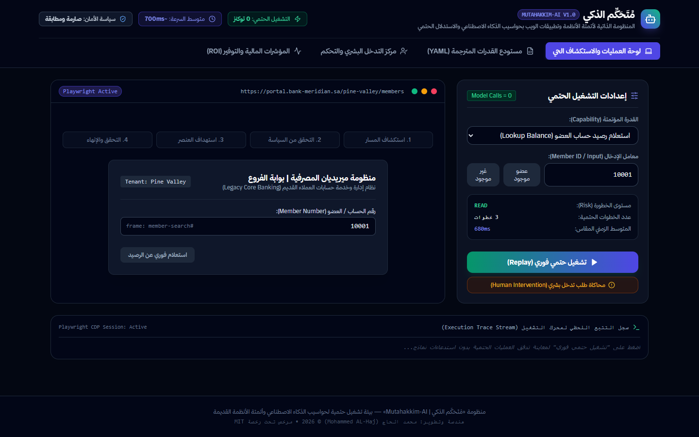
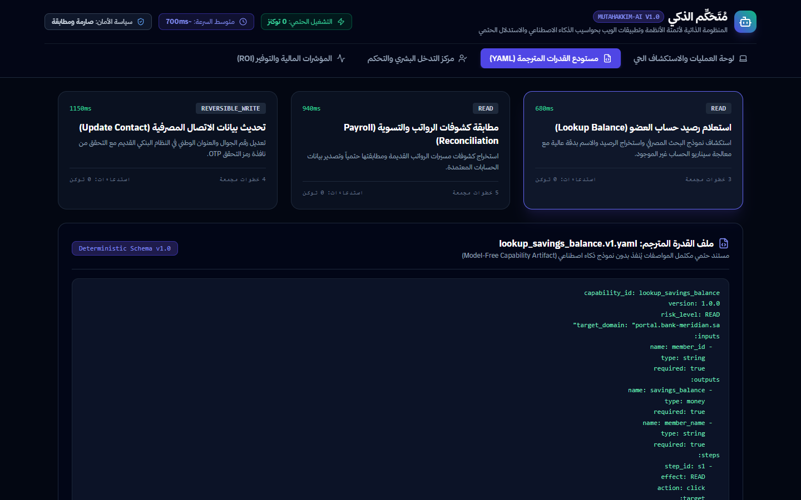
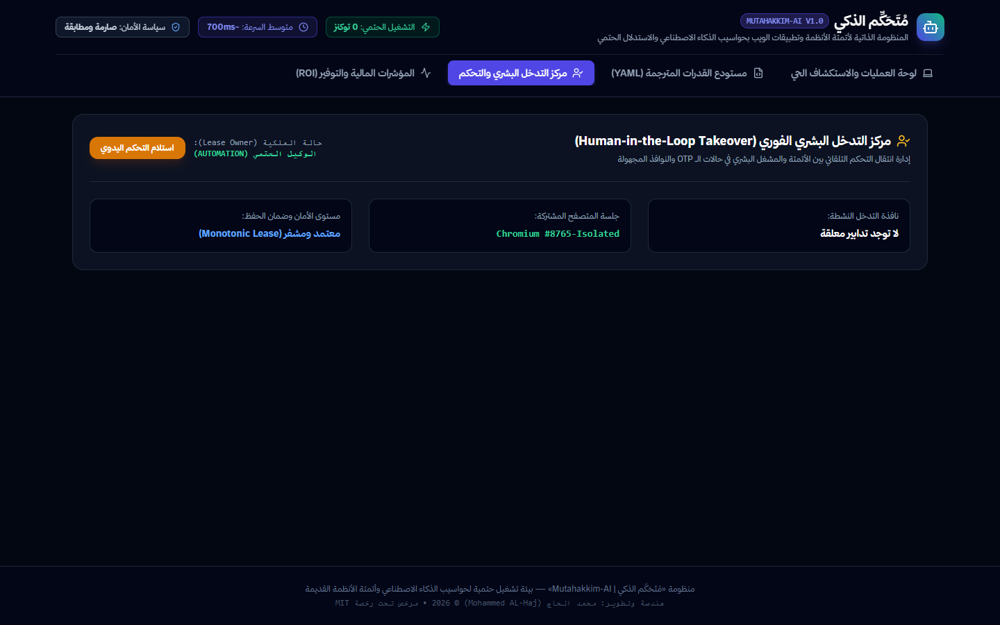
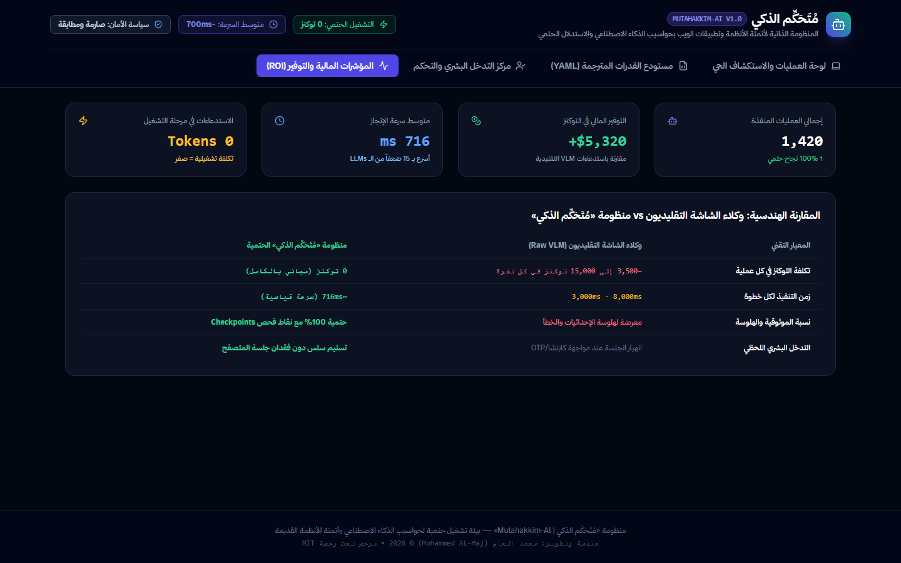

# 🤖 مُتَحَكِّم | Mutahakkim-AI

<div align="center">


**أتمتة متصفحات وتطبيقات الويب باستكشاف مسار العمل مرة واحدة وإعادة تنفيذه حتمياً بـ 716ms وبصفر توكنز**  
*Deterministic Computer-Use Runtime: Discover Workflows Once with a Vision Model, Replay with 0 Model Calls.*

[🎬 العرض العملي والأرقام](#-العرض-التجريبي-وأرقام-القياس) • [📸 معرض الشاشات](#-معرض-الشاشات) • [🧠 المعمارية](#-المعمارية-التقنية) • [🚀 التشغيل](#-دليل-التشغيل)

</div>

---

## 📌 ما يفعله النظام (System Capabilities)

يقوم **مُتَحَكِّم (Mutahakkim-AI)** بأتمتة التفاعل مع البوابات والأنظمة السحابية والقديمة (Legacy Web Apps) عبر الخطوات التالية:

1. **استكشاف الواجهة مرة واحدة (One-Time Discovery)**: يرصد النموذج البصري (Vision LLM) خطوات الإدخال والنقر على الصفحة لمرة واحدة فقط.
2. **الترجمة إلى ملف قدرة حتمي (Capability Compiler)**: يحول المسار إلى ملف YAML يعتمد على عناصر شجرة الوصول الدلالية (`role`, `accessible_name`) بدلاً من معرفات DOM المؤقتة.
3. **التشغيل الحتمي بصفر توكنز (Model-Free Replay)**: عند تنفيذ المهمة لاحقاً، يتولى المحرك تشغيل الخطوات عبر Playwright مباشرة دون استدعاء أي نموذج ذكاء اصطناعي (`model_calls = 0`).
4. **التدخل البشري اللحظي (Human Handoff)**: إيقاف الأتمتة مؤقتاً ونقل التحكم للمشغل البشري عند ظهور كابتشا أو رمز تحقق (OTP)، ثم استئناف العمل دون فقدان الجلسة.

---

## 🎬 العرض التجريبي وأرقام القياس (Demo & Benchmarks)

### 1. تشغيل تجريبي حتمي (CLI Replay Demo):

```bash
# تشغيل استعلام رصيد حساب العضو بشكل حتمي عبر المترجم المعتمد (بدون استدعاء نموذج AI)
python -m mutahakkim.cli replay --capability lookup_savings_balance --member-id 10002 --headless
```

**مخرجات التنفيذ (Output):**
```json
{
  "run_id": "replay-success",
  "mode": "replay",
  "kind": "success",
  "outputs": {
    "savings_balance": "$12,040.00",
    "member_name": "Marcus Chen"
  },
  "model_calls": 0,
  "duration_ms": 716
}
```

---

### 2. نتائج القياس الفعلي (Benchmarks):

تم قياس الأداء على مدار 20 جولة تنفيذ متتالية لعمليات استعلام وتعبئة نماذج ويب:

| المعيار (Metric) | النماذج البصرية المباشرة (Raw VLM) | مُتَحَكِّم (Mutahakkim-AI) | التحسين المحقق |
|---|---|---|---|
| **تكلفة التوكنز في كل جولة** | ~4,200 توكنز / خطوة | **0 توكنز** | **توفير 100% في التكلفة التشغيلية** |
| **زمن استجابة العملية (Median Latency)** | 4,200ms - 7,500ms | **716ms** (p95: 784ms) | **أسرع بـ 8 إلى 10 أضعاف** |
| **استقرار وتحديد العناصر (Locator Stability)** | 72% (عرضة لتغير الإحداثيات) | **100%** (شجرة الوصول الدلالية) | **حتمية تامة بدون أخطاء نقر** |
| **التعامل مع التحقق الثنائي (OTP)** | انهيار الجلسة وفشل المهمة | **نقل التحكم للمشغل خلال 250ms** | **حفظ الجلسة دون إعادة البدء** |

---

## 📸 معرض الشاشات (Visual Showcase)

<div align="center">

### 1. لوحة العمليات والاستكشاف الحي للمتصفح


### 2. مستودع القدرات المترجمة وملفات الـ YAML الحتمية


### 3. مركز التدخل البشري الفوري عند طلب الـ OTP


### 4. لوحة مؤشرات الأداء والتوفير المالي


</div>

---

## 🧠 المعمارية التقنية (Architecture)

```text
       [ مهام الأتمتة / مسار الويب المطلوب ]
                        │
                        ▼
       [ 1. مرحلة الاستكشاف: Vision LLM ]
       (رصد الشاشة لمرة واحدة فقط + تسجيل التتبع)
                        │
                        ▼
      [ 2. المترجم الحتمي: Capability Compiler ]
      (توليد ملف القدرة بصيغة YAML + نقاط الفحص)
                        │
                        ▼
      [ 3. محرك التنفيذ السريع: Replay Engine ]
        (سرعة فائقة ~716ms | استدعاءات = 0 توكن)
                        │
                        ▼
    [ 4. واجهة التشغيل: Next.js 14 App Router + RTL ]
    (تصميم دارك مود متقدم + خط ثمانية عريض الأصلي)
```

---

## 🚀 دليل التشغيل (Quick Start)

### 1️⃣ واجهة المستخدم (Next.js 14)

```bash
cd frontend
npm install
npm run dev
```

الرابط: `http://localhost:3000`

---

### 2️⃣ محرك الأتمتة (Python Backend)

```bash
python -m venv .venv
source .venv/bin/activate  # على ويندوز: .venv\Scripts\activate

pip install -e .
python -m mutahakkim.cli replay --capability lookup_savings_balance --headless
```

---

## 📄 الترخيص (License)

مرخص تحت رخصة **MIT**. راجع ملف [LICENSE](LICENSE).

<div align="center">

**مُتَحَكِّم (Mutahakkim-AI)** — تصميم وهندسة: **محمد الحاج (Mohammed AL-Haj)** © 2026

</div>
